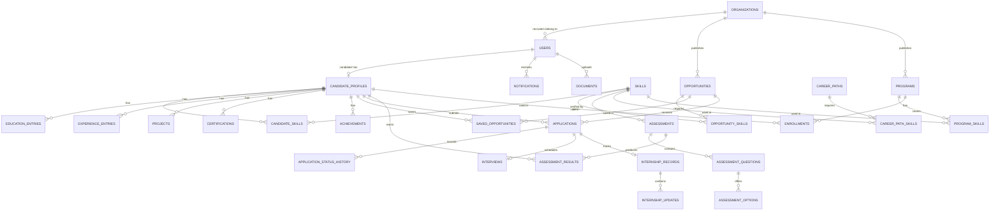
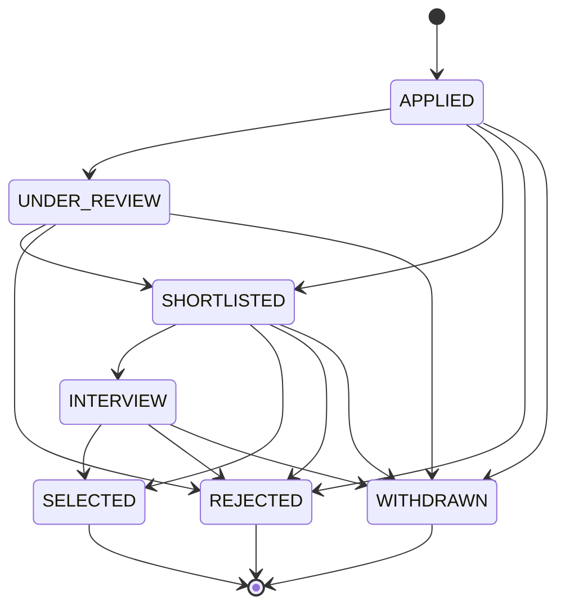

# SkillBridge: Backend and Database Design

This document describes the backend that the SkillBridge frontend expects. It is based on what the frontend actually does, and is the contract for building the backend with **Java Spring Boot, MySQL, JWT and REST**, the stack proposed in the project report.

The frontend already talks to this API through an in-browser mock (`src/mocks/`). Each endpoint in section 9 exists in that mock, so the mock handlers are a working reference for the expected behaviour.

## Contents

1. [Connecting the backend](#1-connecting-the-backend)
2. [Design decisions](#2-design-decisions)
3. [Authentication and authorization](#3-authentication-and-authorization)
4. [Enums](#4-enums)
5. [Entities](#5-entities)
6. [Relationships](#6-relationships)
7. [Application lifecycle](#7-application-lifecycle)
8. [Business rules](#8-business-rules)
9. [REST API](#9-rest-api)
10. [Example records](#10-example-records)
11. [File uploads](#11-file-uploads)
12. [Indexes](#12-indexes)
13. [Known gaps to close](#13-known-gaps-to-close)

---

## 1. Connecting the backend

Set one environment variable in the frontend, then restart it:

```
VITE_API_BASE_URL=http://localhost:8080/api/v1
```

All requests then go to that address, and the mock code is no longer downloaded. The demo-only messages and demo accounts also disappear.

The backend must follow these conventions, because the frontend depends on them:

| Convention | Requirement |
|---|---|
| IDs | Returned as **JSON strings**. The frontend compares them with URL parameters using `===`. Use UUIDs, as shown in this document. A numeric `Long` would break those comparisons. |
| Dates | ISO-8601 strings in UTC, such as `2026-11-07T10:30:00Z` |
| Auth header | `Authorization: Bearer <token>` |
| Unauthorized | `401` when the token is missing, invalid or expired. The frontend then ends the session. |
| Errors | `{ "message": "Readable text", "fieldErrors": { "fieldName": "Readable text" } }`. `fieldErrors` is optional and appears beside the matching form field. |
| Status codes | `400` validation, `401` not signed in, `403` wrong role or owner, `404` not found, `409` conflict with current state |
| Pagination | `{ "items": [], "total": 0, "page": 1, "pageSize": 9, "totalPages": 1 }`. Pages start at 1. |
| CORS | Allow the frontend origin, the `Authorization` header, and `GET, POST, PUT, PATCH, DELETE` |
| Field names | camelCase JSON, matching the examples in this document |

---

## 2. Design decisions

| Decision | Reason |
|---|---|
| **Only two login roles:** `CANDIDATE` and `RECRUITER` | A project requirement. Candidate category and organization type are profile attributes and never affect the login system. |
| **The report's four roles map onto those two** | Students, graduates, professionals and academicians are candidates. Industries, colleges, universities and institutions are recruiters. Institutions get extra screens based on organization type, not a separate role. |
| **One `opportunities` table** for jobs and internships | They share almost every field, and applications treat them the same way. A `type` column separates them. |
| **One `programs` table** for all learning and collaboration types | Training, workshops, mentorship, FDPs, research and the rest share the same fields and the same registration flow. A `type` column separates them. |
| **Skills are a catalog plus link tables** | Matching needs consistent names. Candidates may add a new skill, which creates a catalog entry. |
| **Postings are soft deleted** | Candidates keep their application history after a posting is removed. |
| **Posting state is calculated, not stored** | `EXPIRED` depends on today's date, so storing it would go stale. See [section 8](#posting-state). |

### How the requested modules map to tables

| Requested model | Table |
|---|---|
| User | `users` |
| CandidateProfile | `candidate_profiles` |
| Organization | `organizations` |
| Job, Internship | `opportunities` (`type` = `JOB` or `INTERNSHIP`) |
| Application | `applications`, `application_status_history`, `interviews` |
| Skill, CandidateSkill | `skills`, `candidate_skills` |
| SkillAssessment | `assessments`, `assessment_questions`, `assessment_options` |
| AssessmentResult | `assessment_results` |
| Certification, Project | `certifications`, `projects` |
| TrainingProgram, Workshop, Mentorship, FacultyOpportunity | `programs` (`type` column), `enrollments` |
| Notification | `notifications` |
| SavedOpportunity | `saved_opportunities` |
| *Added:* career paths for skill mapping | `career_paths`, `career_path_skills` |
| *Added:* internship tracking, from the report | `internship_records`, `internship_updates` |
| *Added:* resumes and other files | `documents` |

---

## 3. Authentication and authorization

### Passwords and tokens

- Hash passwords with **BCrypt** (Spring Security's `BCryptPasswordEncoder`). Never return the hash.
- Issue a signed **JWT** on login and registration, with the claims `sub` (user ID) and `role`. A lifetime of 24 hours suits the current frontend, which has no refresh flow.
- Passwords need at least 8 characters.
- `POST /auth/forgot-password` must return success whether or not the email exists, so that it cannot be used to discover accounts.

### Access rules

Hiding pages in the frontend is not security. **The backend must enforce every rule below.**

| Access | Who |
|---|---|
| Public | Browse opportunities and programs, statistics, organizations, skill catalog, public portfolios, register, login, newsletter |
| `CANDIDATE` | Their own profile, applications, saved items, assessments, enrollments, skill mapping |
| `RECRUITER` | Their own organization, postings, programs and received applications, plus candidate search and candidate profiles |
| Any signed-in user | Their own account, notifications and password |

### Ownership rules

| Rule | Failure |
|---|---|
| A recruiter can edit only postings and programs where `organization_id` matches their own | `403` |
| A recruiter can see and update only applications to their own postings | `403` |
| A candidate can see and withdraw only their own applications | `404` |
| A notification is visible only to its `user_id` | `404` |
| A private portfolio (`portfolio_public = false`) is visible only to its owner and to recruiters | `403` |
| Institution insights need organization type `COLLEGE`, `UNIVERSITY` or `EDUCATIONAL_INSTITUTION` | `403` |
| Assessment answer keys are never sent before submission | Not applicable |

### Login role check

`POST /auth/login` receives the role of the login page being used. If the account has a different role, return `403` with: `This is a Recruiter account. Please use the Recruiter login.`

---

## 4. Enums

Store these as `VARCHAR` with Java enums (`@Enumerated(EnumType.STRING)`). The frontend definitions are in `src/constants/index.js`.

| Enum | Values |
|---|---|
| `Role` | `CANDIDATE`, `RECRUITER` |
| `UserStatus` | `ACTIVE`, `SUSPENDED` |
| `CandidateCategory` | `STUDENT`, `GRADUATE`, `PROFESSIONAL`, `ACADEMICIAN` |
| `OrganizationType` | `IT_COMPANY`, `NON_IT_COMPANY`, `COLLEGE`, `UNIVERSITY`, `EDUCATIONAL_INSTITUTION`, `STARTUP`, `TRAINING_INSTITUTE`, `OTHER` |
| `VerificationStatus` | `UNVERIFIED`, `PENDING`, `VERIFIED` |
| `OpportunityType` | `JOB`, `INTERNSHIP` |
| `PostingStatus` (stored) | `ACTIVE`, `CLOSED` |
| `PostingState` (calculated) | `ACTIVE`, `CLOSED`, `EXPIRED` |
| `WorkMode` | `REMOTE`, `HYBRID`, `ONSITE` |
| `EmploymentType` | `FULL_TIME`, `PART_TIME`, `CONTRACT`, `APPRENTICESHIP` |
| `ExperienceLevel` | `FRESHER`, `JUNIOR`, `MID`, `SENIOR` |
| `Currency` | `INR`, `USD`, `EUR`, `GBP`, `SGD` |
| `PayPeriod` | `MONTH`, `YEAR` |
| `ApplicationStatus` | `APPLIED`, `UNDER_REVIEW`, `SHORTLISTED`, `INTERVIEW`, `SELECTED`, `REJECTED`, `WITHDRAWN` |
| `InterviewMode` | `VIDEO`, `PHONE`, `IN_PERSON` |
| `SkillType` | `TECHNICAL`, `SOFT`, `APTITUDE` |
| `SkillLevel` | `BEGINNER` (1), `INTERMEDIATE` (2), `ADVANCED` (3), `EXPERT` (4) |
| `AssessmentKind` | `TECHNICAL`, `SOFT`, `APTITUDE` |
| `ProgramType` (learning) | `TRAINING`, `CERTIFICATION`, `WORKSHOP`, `MENTORSHIP`, `LIVE_PROJECT` |
| `ProgramType` (collaboration) | `GUEST_LECTURE`, `RESEARCH`, `FDP`, `FACULTY_INTERNSHIP`, `INDUSTRIAL_TRAINING`, `CONSULTANCY`, `INNOVATION_CHALLENGE` |
| `EnrollmentStatus` | `ENROLLED`, `COMPLETED`, `CANCELLED` |
| `NotificationType` | `APPLICATION`, `INTERVIEW`, `ASSESSMENT`, `PROGRAM`, `SYSTEM` |
| `DocumentType` | `RESUME`, `CERTIFICATE`, `INTERNSHIP_REPORT`, `ACADEMIC_RECORD`, `ORGANIZATION_LOGO` |

---

## 5. Entities

Primary keys are `id CHAR(36)` (UUID) unless stated. In the tables, **Req** means required, and **FK** is a foreign key. Tables with `created_at` also have `updated_at`, both `DATETIME` in UTC.

### users

| Column | Type | Req | Notes |
|---|---|---|---|
| id | CHAR(36) | Yes | PK |
| email | VARCHAR(255) | Yes | Unique, stored in lowercase, valid email format |
| password_hash | VARCHAR(255) | Yes | BCrypt |
| role | VARCHAR(20) | Yes | `Role`. Cannot be changed. |
| name | VARCHAR(150) | Yes | Display name |
| status | VARCHAR(20) | Yes | `UserStatus`, default `ACTIVE` |
| organization_id | CHAR(36) | Recruiters | FK to `organizations` |
| email_applications | BOOLEAN | Yes | Preference, default true |
| email_opportunities | BOOLEAN | Yes | Preference, default true |
| email_programs | BOOLEAN | Yes | Preference, default false |
| created_at | DATETIME | Yes | |

The API returns the three preferences as a `preferences` object.

### candidate_profiles

One per candidate user.

| Column | Type | Req | Notes |
|---|---|---|---|
| id | CHAR(36) | Yes | PK. This is the `candidateId` used by the API. |
| user_id | CHAR(36) | Yes | FK to `users`, unique |
| category | VARCHAR(20) | Yes | `CandidateCategory` |
| full_name | VARCHAR(150) | Yes | |
| headline | VARCHAR(255) | No | |
| phone | VARCHAR(20) | No | 7 to 20 digits, spaces, `+ ( ) -` |
| location | VARCHAR(150) | No | |
| bio | TEXT | No | |
| university | VARCHAR(255) | No | |
| institution_organization_id | CHAR(36) | No | FK to `organizations`. See [Known gaps](#13-known-gaps-to-close). |
| degree | VARCHAR(255) | No | |
| graduation_year | SMALLINT | No | 1960 to the current year + 8 |
| cgpa | VARCHAR(20) | No | Free text, as it may be a percentage |
| department | VARCHAR(150) | No | Academicians |
| designation | VARCHAR(150) | No | Academicians |
| github_url | VARCHAR(500) | No | `http` or `https` only |
| linkedin_url | VARCHAR(500) | No | `http` or `https` only |
| portfolio_public | BOOLEAN | Yes | Default **false** for new accounts |
| resume_document_id | CHAR(36) | No | FK to `documents`. The current resume. |
| created_at | DATETIME | Yes | |

The API returns `email` from `users`, along with `skills`, `education`, `experience`, `projects`, `certifications`, `achievements` and `resume` from the tables below.

### organizations

| Column | Type | Req | Notes |
|---|---|---|---|
| id | CHAR(36) | Yes | PK |
| name | VARCHAR(255) | Yes | |
| type | VARCHAR(30) | Yes | `OrganizationType` |
| industry | VARCHAR(150) | No | |
| location | VARCHAR(150) | No | |
| description | TEXT | No | |
| website | VARCHAR(500) | No | `http` or `https` only |
| contact_email | VARCHAR(255) | No | |
| contact_phone | VARCHAR(20) | No | |
| size | VARCHAR(20) | No | Such as `51–200` |
| founded_year | SMALLINT | No | 1800 to the current year |
| logo_document_id | CHAR(36) | No | FK to `documents`, returned as `logoUrl` |
| verification_status | VARCHAR(20) | Yes | `VerificationStatus`, default `UNVERIFIED` |
| created_at | DATETIME | Yes | |

The frontend also reads an optional `logoColor`, a Tailwind class for the placeholder logo. The backend can omit it, or the frontend can derive a colour from the name.

### skills

| Column | Type | Req | Notes |
|---|---|---|---|
| id | CHAR(36) | Yes | PK |
| name | VARCHAR(100) | Yes | Unique, not case-sensitive |
| type | VARCHAR(20) | Yes | `SkillType` |
| category | VARCHAR(100) | No | Such as `Web` or `Data & AI` |

### candidate_skills

Many-to-many between candidates and skills. PK is (`candidate_id`, `skill_id`).

| Column | Type | Req | Notes |
|---|---|---|---|
| candidate_id | CHAR(36) | Yes | FK |
| skill_id | CHAR(36) | Yes | FK |
| level | VARCHAR(20) | Yes | `SkillLevel` |
| verified | BOOLEAN | Yes | Default false. Only a passed assessment sets it to true. |

### education_entries, experience_entries, projects, certifications, achievements

Each is one-to-many from `candidate_profiles`, with `id` and `candidate_id` (FK, cascade delete).

| Table | Column | Type | Req |
|---|---|---|---|
| education_entries | institution | VARCHAR(255) | Yes |
| | degree | VARCHAR(255) | Yes |
| | period | VARCHAR(50) | Yes |
| | score | VARCHAR(100) | No |
| experience_entries | title | VARCHAR(150) | Yes |
| | company | VARCHAR(255) | Yes |
| | period | VARCHAR(50) | Yes |
| | type | VARCHAR(50) | No |
| | description | TEXT | No |
| | verified | BOOLEAN | Yes, default false. True when created from a completed internship. |
| projects | title | VARCHAR(255) | Yes |
| | description | TEXT | Yes |
| | tags | JSON | No, array of strings |
| | link | VARCHAR(500) | No, `http` or `https` only |
| certifications | name | VARCHAR(255) | Yes |
| | issuer | VARCHAR(255) | Yes |
| | date | VARCHAR(50) | Yes, displayed as entered |
| | credential_url | VARCHAR(500) | No |
| achievements | text | TEXT | Yes |

### career_paths and career_path_skills

Reference data for skill mapping.

| Table | Column | Type | Req | Notes |
|---|---|---|---|---|
| career_paths | id | CHAR(36) | Yes | PK |
| | title | VARCHAR(150) | Yes | |
| | description | TEXT | Yes | |
| | next_roles | JSON | Yes | Array of strings |
| | salary_band | VARCHAR(100) | No | |
| career_path_skills | career_path_id | CHAR(36) | Yes | FK, part of PK |
| | skill_id | CHAR(36) | Yes | FK, part of PK |
| | level | VARCHAR(20) | Yes | Required `SkillLevel` |

The starting data is in `src/data/skills.js`.

### opportunities

| Column | Type | Req | Notes |
|---|---|---|---|
| id | CHAR(36) | Yes | PK |
| organization_id | CHAR(36) | Yes | FK |
| type | VARCHAR(20) | Yes | `OpportunityType` |
| title | VARCHAR(255) | Yes | |
| description | TEXT | Yes | |
| responsibilities | JSON | No | Array of strings |
| qualifications | JSON | No | Array of strings |
| eligibility | TEXT | Yes | |
| location | VARCHAR(150) | Yes | |
| work_mode | VARCHAR(20) | Yes | `WorkMode` |
| employment_type | VARCHAR(20) | Jobs | `EmploymentType`, null for internships |
| duration_months | SMALLINT | Internships | 1 to 24, null for jobs |
| experience_level | VARCHAR(20) | Yes | `ExperienceLevel` |
| pay_min | DECIMAL(14,2) | No | 0 or more |
| pay_max | DECIMAL(14,2) | No | Must be at least `pay_min` |
| pay_currency | VARCHAR(3) | With pay | `Currency` |
| pay_period | VARCHAR(10) | With pay | `PayPeriod` |
| openings | INT | Yes | 1 to 1000 |
| deadline | DATETIME | Yes | Cannot be in the past on create, or when changed |
| status | VARCHAR(20) | Yes | `PostingStatus`, default `ACTIVE` |
| featured | BOOLEAN | Yes | Default false. Set by the platform, not by recruiters. |
| view_count | INT | Yes | Default 0. Goes up on each detail view. |
| deleted_at | DATETIME | No | Soft delete |
| created_at | DATETIME | Yes | |

The API returns pay as `compensation: { min, max, currency, period }`, or `null` when unpaid.

### opportunity_skills

PK is (`opportunity_id`, `skill_id`). At least one per posting, with no duplicates.

| Column | Type | Req | Notes |
|---|---|---|---|
| opportunity_id | CHAR(36) | Yes | FK |
| skill_id | CHAR(36) | Yes | FK |
| level | VARCHAR(20) | Yes | Required `SkillLevel` |

### saved_opportunities

PK is (`candidate_id`, `opportunity_id`).

| Column | Type | Req |
|---|---|---|
| candidate_id | CHAR(36) | Yes, FK |
| opportunity_id | CHAR(36) | Yes, FK |
| saved_at | DATETIME | Yes |

### applications

**Unique** on (`candidate_id`, `opportunity_id`). A candidate who withdraws cannot apply again.

| Column | Type | Req | Notes |
|---|---|---|---|
| id | CHAR(36) | Yes | PK |
| opportunity_id | CHAR(36) | Yes | FK |
| candidate_id | CHAR(36) | Yes | FK |
| status | VARCHAR(20) | Yes | `ApplicationStatus`, default `APPLIED` |
| cover_note | TEXT | No | Up to 1000 characters |
| resume_document_id | CHAR(36) | No | The resume **at the time of applying**. It stays even if the candidate later replaces their resume. |
| match_score | TINYINT | Yes | 0 to 100, calculated when applying |
| applied_at | DATETIME | Yes | |
| updated_at | DATETIME | Yes | |

### application_status_history

Returned as the application's `timeline`, in date order.

| Column | Type | Req | Notes |
|---|---|---|---|
| id | CHAR(36) | Yes | PK |
| application_id | CHAR(36) | Yes | FK |
| status | VARCHAR(20) | Yes | `ApplicationStatus` |
| note | VARCHAR(500) | No | |
| changed_at | DATETIME | Yes | Returned as `at` |
| changed_by_user_id | CHAR(36) | Yes | FK. Useful for audit. |

### interviews

One per application. Rescheduling replaces it.

| Column | Type | Req | Notes |
|---|---|---|---|
| application_id | CHAR(36) | Yes | PK and FK |
| scheduled_at | DATETIME | Yes | Must be in the future |
| mode | VARCHAR(20) | Yes | `InterviewMode` |
| details | TEXT | No | Link, address or preparation notes |

### internship_records and internship_updates

The report's internship progress tracking, mentor feedback and completion records.

| Table | Column | Type | Req | Notes |
|---|---|---|---|---|
| internship_records | application_id | CHAR(36) | Yes | PK and FK |
| | progress | TINYINT | Yes | 0 to 100 |
| | started_at | DATETIME | Yes | |
| | completed_at | DATETIME | No | Once set, the record cannot change |
| internship_updates | id | CHAR(36) | Yes | PK |
| | application_id | CHAR(36) | Yes | FK |
| | note | TEXT | Yes | Mentor feedback or milestone |
| | mentor_name | VARCHAR(150) | No | |
| | progress | TINYINT | Yes | Progress at the time |
| | created_at | DATETIME | Yes | Returned as `at` |

### assessments, assessment_questions, assessment_options

| Table | Column | Type | Req | Notes |
|---|---|---|---|---|
| assessments | id | CHAR(36) | Yes | PK |
| | title | VARCHAR(150) | Yes | |
| | kind | VARCHAR(20) | Yes | `AssessmentKind` |
| | skill_id | CHAR(36) | Yes | FK. The skill this assessment verifies. |
| | description | VARCHAR(500) | Yes | |
| | duration_minutes | SMALLINT | Yes | |
| assessment_questions | id | CHAR(36) | Yes | PK |
| | assessment_id | CHAR(36) | Yes | FK |
| | text | TEXT | Yes | |
| | position | SMALLINT | Yes | Display order |
| assessment_options | id | CHAR(36) | Yes | PK |
| | question_id | CHAR(36) | Yes | FK |
| | text | VARCHAR(500) | Yes | |
| | position | SMALLINT | Yes | The frontend sends this index as the answer |
| | is_correct | BOOLEAN | Yes | **Never sent before submission** |

The starting questions are in `src/data/assessments.js`.

### assessment_results

| Column | Type | Req | Notes |
|---|---|---|---|
| id | CHAR(36) | Yes | PK |
| assessment_id | CHAR(36) | Yes | FK |
| candidate_id | CHAR(36) | Yes | FK. Retakes add new rows. |
| score | TINYINT | Yes | 0 to 100 |
| level | VARCHAR(20) | Yes | `SkillLevel` |
| correct_count | SMALLINT | Yes | |
| total_questions | SMALLINT | Yes | |
| taken_at | DATETIME | Yes | |

### programs

| Column | Type | Req | Notes |
|---|---|---|---|
| id | CHAR(36) | Yes | PK |
| organization_id | CHAR(36) | Yes | FK |
| type | VARCHAR(30) | Yes | `ProgramType` |
| title | VARCHAR(255) | Yes | |
| description | TEXT | Yes | |
| audience | JSON | Yes | Non-empty array of `CandidateCategory` |
| mode | VARCHAR(20) | Yes | `WorkMode` |
| location | VARCHAR(150) | Yes | |
| start_date | DATETIME | Yes | |
| deadline | DATETIME | Yes | Registration closes after this |
| duration | VARCHAR(50) | Yes | Free text, such as `8 weeks` |
| fee_amount | DECIMAL(12,2) | No | Null or 0 means free. Returned as `fee: { amount, currency }`. |
| fee_currency | VARCHAR(3) | With fee | |
| seats | INT | Yes | 1 to 10000 |
| stipend_note | VARCHAR(255) | No | Such as `Grant funded` |
| status | VARCHAR(20) | Yes | `PostingStatus`, default `ACTIVE` |
| created_at | DATETIME | Yes | |

`program_skills` links programs to skills, with PK (`program_id`, `skill_id`). The API returns `skills` as an array of names.

### enrollments

**Unique** on (`program_id`, `candidate_id`).

| Column | Type | Req | Notes |
|---|---|---|---|
| id | CHAR(36) | Yes | PK |
| program_id | CHAR(36) | Yes | FK |
| candidate_id | CHAR(36) | Yes | FK |
| status | VARCHAR(20) | Yes | `EnrollmentStatus`, default `ENROLLED` |
| progress | TINYINT | Yes | 0 to 100, default 0 |
| enrolled_at | DATETIME | Yes | |

### notifications

| Column | Type | Req | Notes |
|---|---|---|---|
| id | CHAR(36) | Yes | PK |
| user_id | CHAR(36) | Yes | FK |
| type | VARCHAR(20) | Yes | `NotificationType` |
| title | VARCHAR(150) | Yes | |
| message | VARCHAR(500) | Yes | |
| link | VARCHAR(255) | No | A frontend path, such as `/candidate/applications` |
| read | BOOLEAN | Yes | Default false. `read` is reserved in some SQL dialects, so name the column `is_read`. |
| created_at | DATETIME | Yes | |

### documents

Details of every uploaded file. See [section 11](#11-file-uploads).

| Column | Type | Req | Notes |
|---|---|---|---|
| id | CHAR(36) | Yes | PK |
| owner_user_id | CHAR(36) | Yes | FK |
| type | VARCHAR(30) | Yes | `DocumentType` |
| file_name | VARCHAR(255) | Yes | Original name, for display only |
| content_type | VARCHAR(100) | Yes | |
| size_bytes | BIGINT | Yes | Returned as `fileSize` |
| storage_key | VARCHAR(500) | Yes | Location in storage. Never returned. |
| uploaded_at | DATETIME | Yes | Returned as `uploadedAt` |

### Supporting tables

| Table | Columns | Purpose |
|---|---|---|
| newsletter_subscribers | email (PK), created_at | Footer sign-up |
| password_reset_tokens | token_hash (PK), user_id, expires_at, used_at | Password reset |

---

## 6. Relationships



| Type | Relationship |
|---|---|
| One-to-one | `users` and `candidate_profiles`; `applications` and `interviews`; `applications` and `internship_records` |
| One-to-many | `organizations` to `users`, `opportunities` and `programs`; `candidate_profiles` to each profile section, `applications` and `assessment_results`; `applications` to `application_status_history` |
| Many-to-many | Candidates and skills; opportunities and skills; programs and skills; career paths and skills; candidates and saved opportunities; candidates and programs, through `enrollments` |

---

## 7. Application lifecycle



| Rule | Detail |
|---|---|
| Invalid move | Return `409` with a readable message. The table is `APPLICATION_TRANSITIONS` in `src/constants/index.js`. |
| Moving to `INTERVIEW` | Only through `PUT /applications/{id}/interview`, because an interview needs a date. `PATCH .../status` with `INTERVIEW` returns `400`. |
| Moving to `WITHDRAWN` | Candidate only, through `POST /applications/{id}/withdraw`. Recruiters get `403`. |
| Every change | Add a row to `application_status_history` and notify the other side. |
| Final states | `SELECTED`, `REJECTED` and `WITHDRAWN` allow no further moves. |

### Notifications to create

| Event | Recipient | Title |
|---|---|---|
| Candidate applies | Recruiter | New application received |
| Candidate withdraws | Recruiter | Application withdrawn |
| Status changes | Candidate | Application update: *status* |
| Interview scheduled | Candidate | Interview scheduled |
| Internship feedback added or completed | Candidate | New internship feedback / Internship completed |
| Posting deleted, with applications still open | Those candidates | Posting removed |
| Assessment passed | Candidate | Skill verified |
| Candidate registers for a program | Recruiter | New registration |
| Program deleted | Registered candidates | Program cancelled |

---

## 8. Business rules

### Skill match score

Used for job matching, recommendations, skill mapping and candidate ranking. The reference is `computeMatch` in `src/utils/skillMatch.js`.

```
for each required skill:
    candidate does not have it           → 0 points, listed as "missing"
    candidate level >= required level    → 1 point, listed as "matched"
    candidate level <  required level    → candidate rank / required rank, listed as "partial"

score = round(points / number of required skills × 100)
```

Levels rank from `BEGINNER` = 1 to `EXPERT` = 4. Skill names are compared without regard to case. Labels: 75 and above is a strong match, 50 to 74 is a good match, and below 50 is a skill gap.

### Posting state

Applies to opportunities and programs:

```
status = CLOSED                      → CLOSED
deadline is before the end of today  → EXPIRED
otherwise                            → ACTIVE
```

- Public lists show only `ACTIVE` items.
- Only `ACTIVE` items accept applications or registrations. Otherwise return `409`.
- Reopening a posting whose deadline has passed returns `409`, asking the recruiter to set a new deadline first.

### Recommendations

`GET /opportunities/recommended` returns the top 6 active opportunities by match score, leaving out those the candidate already applied to. Students and graduates see only `FRESHER` and `JUNIOR` roles.

### Assessment scoring

| Score | Level | Result |
|---|---|---|
| 90 to 100 | `EXPERT` | Passed |
| 70 to 89 | `ADVANCED` | Passed |
| 50 to 69 | `INTERMEDIATE` | Passed |
| Below 50 | `BEGINNER` | Not passed |

A pass adds or updates the candidate's skill, with that level and `verified = true`. A fail records the result and leaves the skill unchanged. Candidates cannot change the level of a verified skill by hand, which returns `409`.

### Skill mapping

For each career path, calculate `readiness` with the match formula, then sort from highest to lowest. Also return:

- `recommendedPrograms`: up to 3 active programs open to the candidate's category that cover a missing or partial skill.
- `matchingOpportunities`: up to 3 active opportunities sharing at least 2 skills with the path, most shared first.

### Profile completion

Reference: `profileChecklist` in `src/utils/skillMatch.js`. The frontend calculates this, so the backend does not need to.

### Internship tracking

- Only for an application with status `SELECTED` on an `INTERNSHIP`.
- Marking it complete sets progress to 100 and `completed_at`, and adds a verified entry to the candidate's experience.
- A completed record cannot change.

### Deleting

| Action | Effect |
|---|---|
| Delete posting | Soft delete. Remove from saved lists, and notify candidates with open applications. Application history stays. |
| Delete program | Remove it and its enrollments, and notify registered candidates. |
| Delete candidate account | Remove the profile, applications, enrollments, saved items and results. |
| Delete recruiter account | Remove the login, and close the organization's postings and programs. |

---

## 9. REST API

Base path: `/api/v1`. **Auth** shows the required role: Public, Candidate, Recruiter or Any (any signed-in user).

### Authentication

| Method | Path | Auth | Body | Returns |
|---|---|---|---|---|
| POST | `/auth/register` | Public | See example | `{ token, user }` |
| POST | `/auth/login` | Public | `{ email, password, role }` | `{ token, user }` |
| POST | `/auth/forgot-password` | Public | `{ email }` | `{ success }` |
| GET | `/auth/me` | Any | | User |
| POST | `/auth/change-password` | Any | `{ currentPassword, newPassword }` | `{ success }` |
| PATCH | `/auth/me/preferences` | Any | Any of the three preference booleans | User |
| DELETE | `/auth/me` | Any | | `{ success }` |

### Candidate profile

| Method | Path | Auth | Body | Returns |
|---|---|---|---|---|
| GET | `/candidates/me` | Candidate | | Full profile |
| PATCH | `/candidates/me` | Candidate | Any editable profile fields | Full profile |
| POST | `/candidates/me/skills` | Candidate | `{ name, level, type }`. Updates the skill if it exists. | Full profile |
| DELETE | `/candidates/me/skills/{name}` | Candidate | | Full profile |
| POST | `/candidates/me/resume` | Candidate | Multipart field `file` | Full profile |
| DELETE | `/candidates/me/resume` | Candidate | | Full profile |
| POST | `/candidates/me/{section}` | Candidate | Entry fields | Full profile |
| PUT | `/candidates/me/{section}/{id}` | Candidate | Entry fields | Full profile |
| DELETE | `/candidates/me/{section}/{id}` | Candidate | | Full profile |
| GET | `/portfolios/{candidateId}` | Public | | Portfolio, without email or phone |

`{section}` is `education`, `experience`, `projects`, `certifications` or `achievements`. These calls return the whole profile, because the frontend replaces its copy with the response.

### Recruiter and organization

| Method | Path | Auth | Body or query | Returns |
|---|---|---|---|---|
| GET | `/organizations/me` | Recruiter | | Organization |
| PATCH | `/organizations/me` | Recruiter | Any editable fields | Organization |
| POST | `/organizations/me/verification` | Recruiter | | Organization, now `PENDING` |
| GET | `/organizations` | Public | | Summaries |
| GET | `/recruiters/me/analytics` | Recruiter | | Analytics |
| GET | `/institutions/me/insights` | Recruiter (institution types) | | Insights |
| GET | `/candidates` | Recruiter | `q, category, skill, location, verifiedOnly, opportunityId, page, pageSize` | Page of summaries. With `opportunityId`, includes `matchScore` and sorts by it. |
| GET | `/candidates/{id}` | Recruiter | | Full profile, `applications` to this organization, `assessmentResults` |

### Opportunities

| Method | Path | Auth | Body or query | Returns |
|---|---|---|---|---|
| GET | `/opportunities` | Public | `q, type, workMode, experienceLevel, organizationType, skill, featured, sort, page, pageSize` | Page |
| GET | `/opportunities/{id}` | Public | | Opportunity. Adds 1 to views. |
| GET | `/opportunities/recommended` | Candidate | | Up to 6 |
| GET | `/opportunities/saved` | Candidate | | List |
| PUT | `/opportunities/{id}/save` | Candidate | | `{ saved: true }` |
| DELETE | `/opportunities/{id}/save` | Candidate | | `{ saved: false }` |
| GET | `/opportunities/mine` | Recruiter | | The organization's postings, in every state |
| POST | `/opportunities` | Recruiter | Posting | Opportunity |
| PUT | `/opportunities/{id}` | Recruiter (owner) | Posting | Opportunity |
| PATCH | `/opportunities/{id}/status` | Recruiter (owner) | `{ status }` | Opportunity |
| DELETE | `/opportunities/{id}` | Recruiter (owner) | | `{ success }` |

`sort` is `recent` (default), `deadline` or `match`. `q` searches title, organization name, location and skills. When the viewer is a signed-in candidate, each opportunity also includes `matchScore`, `isSaved` and `applicationStatus`. The detail endpoint adds `match: { score, matched, partial, missing }`. Do not send `isSaved` to other viewers: the frontend uses its presence to decide whether to show the bookmark.

### Applications

| Method | Path | Auth | Body or query | Returns |
|---|---|---|---|---|
| POST | `/applications` | Candidate | `{ opportunityId, coverNote }` | Application |
| GET | `/applications/mine` | Candidate | | List, newest first |
| POST | `/applications/{id}/withdraw` | Candidate (owner) | | Application |
| GET | `/applications/received` | Recruiter | `opportunityId` | List, including `candidate` |
| PATCH | `/applications/{id}/status` | Recruiter (owner) | `{ status, note }` | Application |
| PUT | `/applications/{id}/interview` | Recruiter (owner) | `{ scheduledAt, mode, details }` | Application |
| PATCH | `/applications/{id}/internship` | Recruiter (owner) | `{ progress, mentorName, note, complete }` | Application |

### Skills and assessments

| Method | Path | Auth | Body | Returns |
|---|---|---|---|---|
| GET | `/skills` | Public | | Catalog |
| GET | `/skill-mapping` | Candidate | | `{ paths, skills }` |
| GET | `/assessments` | Candidate | | Summaries with `questionCount`, no questions |
| GET | `/assessments/{id}` | Candidate | | With questions, **no answers** |
| POST | `/assessments/{id}/submit` | Candidate | `{ answers: { questionId: optionIndex } }` | Result with `passed` and `review` |
| GET | `/assessments/results/mine` | Candidate | | History, newest first |

### Programs

| Method | Path | Auth | Body or query | Returns |
|---|---|---|---|---|
| GET | `/programs` | Public | `group (LEARNING or COLLABORATION), type, audience, q` | List by start date |
| GET | `/programs/mine` | Recruiter | | The organization's programs |
| POST | `/programs` | Recruiter | Program | Program |
| PUT | `/programs/{id}` | Recruiter (owner) | Program | Program |
| DELETE | `/programs/{id}` | Recruiter (owner) | | `{ success }` |
| GET | `/programs/{id}/enrollees` | Recruiter (owner) | | Enrollments with `candidate` |
| POST | `/programs/{id}/enroll` | Candidate | | Enrollment with `program` |
| DELETE | `/programs/{id}/enroll` | Candidate | | `{ success }` |
| GET | `/enrollments/mine` | Candidate | | Enrollments with `program` |

### Notifications and public

| Method | Path | Auth | Returns |
|---|---|---|---|
| GET | `/notifications` | Any | List, newest first |
| PATCH | `/notifications/{id}/read` | Any | Notification |
| POST | `/notifications/read-all` | Any | `{ success }` |
| DELETE | `/notifications/{id}` | Any | `{ success }` |
| GET | `/stats/public` | Public | `{ opportunities, organizations, candidates, programs, assessments }` |
| POST | `/newsletter` | Public | `{ success }` |

### Example requests and responses

**Register a candidate**

```http
POST /api/v1/auth/register
{
  "role": "CANDIDATE",
  "name": "Sneha Kulkarni",
  "email": "sneha@example.com",
  "password": "password123",
  "category": "GRADUATE"
}
```

**Register a recruiter**

```http
POST /api/v1/auth/register
{
  "role": "RECRUITER",
  "name": "Kavya Menon",
  "email": "talent@neuralpulse.example",
  "password": "password123",
  "organizationType": "IT_COMPANY",
  "organizationName": "NeuralPulse Labs"
}
```

**Response to register and login**

```json
{
  "token": "eyJhbGciOiJIUzI1NiJ9...",
  "user": {
    "id": "7f3a1c9e-2b44-4e1a-9d10-3c5e8a7b1f20",
    "email": "sneha@example.com",
    "role": "CANDIDATE",
    "name": "Sneha Kulkarni",
    "status": "ACTIVE",
    "candidateId": "a1b2c3d4-1111-4222-8333-444455556666",
    "category": "GRADUATE",
    "preferences": { "emailApplications": true, "emailOpportunities": true, "emailPrograms": false },
    "createdAt": "2026-11-07T10:30:00Z"
  }
}
```

Recruiter users have `organizationId`, `organizationType` and `organizationName` in place of `candidateId` and `category`. The frontend relies on these for navigation.

**Error: email already registered**

```http
409 Conflict
{ "message": "An account with this email already exists." }
```

**Error: wrong current password**

```http
400 Bad Request
{
  "message": "Your current password is incorrect.",
  "fieldErrors": { "currentPassword": "Your current password is incorrect." }
}
```

**Create a posting**

```http
POST /api/v1/opportunities
{
  "type": "INTERNSHIP",
  "title": "Data Analytics & BI Intern",
  "description": "Support the risk analytics team.",
  "responsibilities": ["Write SQL for reporting"],
  "qualifications": ["Coursework in statistics"],
  "eligibility": "Students and fresh graduates.",
  "requiredSkills": [
    { "name": "SQL", "level": "ADVANCED", "type": "TECHNICAL" },
    { "name": "Communication", "level": "INTERMEDIATE", "type": "SOFT" }
  ],
  "location": "Mumbai, India",
  "workMode": "HYBRID",
  "employmentType": null,
  "durationMonths": 3,
  "experienceLevel": "FRESHER",
  "compensation": { "min": 20000, "max": 28000, "currency": "INR", "period": "MONTH" },
  "openings": 5,
  "deadline": "2026-12-15T18:29:59Z"
}
```

**Submit an assessment**

```http
POST /api/v1/assessments/{id}/submit
{ "answers": { "q1": 1, "q2": 2, "q3": 1, "q4": 2, "q5": 2 } }
```

```json
{
  "id": "c0d1e2f3-0000-4000-8000-000000000001",
  "assessmentId": "e5f6a7b8-0000-4000-8000-000000000002",
  "assessmentTitle": "JavaScript Fundamentals",
  "skillName": "JavaScript",
  "score": 100,
  "level": "EXPERT",
  "passed": true,
  "correctCount": 5,
  "totalQuestions": 5,
  "takenAt": "2026-11-07T11:00:00Z",
  "review": [
    { "questionId": "q1", "selected": 1, "correctIndex": 1, "correct": true }
  ]
}
```

**Update an application's status**

```http
PATCH /api/v1/applications/{id}/status
{ "status": "SHORTLISTED", "note": "Strong project work." }
```

**Recruiter analytics response**

```json
{
  "totals": { "activeJobs": 2, "activeInternships": 2, "expiredPostings": 1, "applications": 20, "shortlisted": 6, "selected": 3, "views": 1254 },
  "statusDistribution": [{ "status": "APPLIED", "count": 3 }],
  "skillDistribution": [{ "skill": "Python", "count": 16 }],
  "trend": [{ "weekEnding": "2026-11-07T00:00:00Z", "applications": 3 }],
  "performance": [
    { "id": "...", "title": "Machine Learning Engineer", "type": "JOB", "state": "ACTIVE", "views": 368, "applications": 5, "shortlisted": 3, "selected": 1 }
  ],
  "recent": []
}
```

`trend` has one entry for each of the last 8 weeks, oldest first, and `recent` holds the 5 latest applications, each with `candidate`. `statusDistribution` includes every status, even with a count of zero.

**Institution insights response**

```json
{
  "totals": { "students": 3, "averageReadiness": 72, "withVerifiedSkills": 1, "inInternships": 0, "placed": 1, "inProcess": 2 },
  "students": [
    { "id": "...", "fullName": "Priya Das", "degree": "B.E. in Electronics", "graduationYear": 2027, "skillCount": 6, "verifiedSkills": 0, "readiness": 83, "applications": 2, "internships": 0, "placementStatus": "IN_PROCESS" }
  ],
  "skillDemand": [{ "skill": "Python", "count": 7 }],
  "rejectionGaps": [{ "skill": "Statistics", "count": 1 }]
}
```

`placementStatus` is `PLACED`, `IN_PROCESS`, `APPLYING` or `NOT_STARTED`.

---

## 10. Example records

These show what the API returns. The IDs are shortened for reading: real ones are full UUIDs.

**CandidateProfile**

```json
{
  "id": "cnd_aarav",
  "userId": "usr_aarav",
  "category": "STUDENT",
  "fullName": "Aarav Sharma",
  "email": "aarav.sharma@iitd.ac.in",
  "headline": "Final-year Computer Science student at IIT Delhi | ML enthusiast",
  "phone": "+91 98765 43210",
  "location": "New Delhi, India",
  "university": "Indian Institute of Technology, Delhi",
  "degree": "B.Tech in Computer Science & Engineering",
  "graduationYear": 2027,
  "cgpa": "8.92",
  "github": "https://github.com/example/aarav-sharma",
  "linkedin": "https://www.linkedin.com/in/example-aarav-sharma",
  "bio": "Passionate undergraduate...",
  "portfolioPublic": true,
  "skills": [{ "name": "Python", "type": "TECHNICAL", "level": "ADVANCED", "verified": true }],
  "education": [{ "id": "edu_1", "institution": "Indian Institute of Technology, Delhi", "degree": "B.Tech", "period": "2023 – 2027", "score": "CGPA: 8.92" }],
  "experience": [{ "id": "exp_1", "title": "Software Engineering Intern", "company": "Bluepeak Software", "period": "May – Jul 2026", "type": "Internship", "description": "..." }],
  "projects": [{ "id": "prj_1", "title": "MedVision", "description": "...", "tags": ["Python", "PyTorch"], "link": "https://github.com/example/medvision" }],
  "certifications": [{ "id": "crt_1", "name": "AWS Certified Cloud Practitioner", "issuer": "Amazon Web Services", "date": "Aug 2025", "credentialUrl": "" }],
  "achievements": [{ "id": "ach_1", "text": "Finalist at Smart India Hackathon 2024" }],
  "resume": { "fileName": "Aarav_Sharma_Resume.pdf", "fileSize": 1468006, "uploadedAt": "2026-10-13T09:00:00Z" },
  "createdAt": "2026-07-10T09:00:00Z"
}
```

**Organization**

```json
{
  "id": "org_neuralpulse",
  "name": "NeuralPulse Labs",
  "type": "IT_COMPANY",
  "industry": "Artificial Intelligence",
  "location": "Bengaluru, India",
  "description": "NeuralPulse Labs builds applied machine learning products...",
  "website": "https://neuralpulselabs.example",
  "contactEmail": "talent@neuralpulselabs.example",
  "contactPhone": "+91 80 4123 7788",
  "size": "51–200",
  "foundedYear": 2017,
  "logoUrl": null,
  "verificationStatus": "VERIFIED",
  "createdAt": "2025-10-03T09:00:00Z"
}
```

**Opportunity** (as seen by a signed-in candidate)

```json
{
  "id": "opp_ai_intern",
  "organizationId": "org_neuralpulse",
  "organization": { "id": "org_neuralpulse", "name": "NeuralPulse Labs", "type": "IT_COMPANY", "industry": "Artificial Intelligence", "location": "Bengaluru, India", "logoUrl": null, "verificationStatus": "VERIFIED" },
  "type": "INTERNSHIP",
  "title": "AI Research & Development Intern",
  "description": "Work with the applied research team...",
  "responsibilities": ["Run and document model experiments"],
  "qualifications": ["Coursework or projects in machine learning"],
  "eligibility": "Final or pre-final year students with a CGPA of 7.5 or above.",
  "requiredSkills": [{ "name": "Python", "level": "ADVANCED", "type": "TECHNICAL" }],
  "location": "Bengaluru, India",
  "workMode": "HYBRID",
  "employmentType": null,
  "durationMonths": 6,
  "experienceLevel": "FRESHER",
  "compensation": { "min": 35000, "max": 45000, "currency": "INR", "period": "MONTH" },
  "openings": 4,
  "deadline": "2026-11-28T10:00:00Z",
  "status": "ACTIVE",
  "state": "ACTIVE",
  "featured": true,
  "viewCount": 412,
  "applicantCount": 6,
  "createdAt": "2026-09-28T10:00:00Z",
  "matchScore": 40,
  "isSaved": false,
  "applicationStatus": "INTERVIEW"
}
```

**Application** (as seen by a recruiter)

```json
{
  "id": "app_01",
  "opportunityId": "opp_ai_intern",
  "candidateId": "cnd_aarav",
  "status": "INTERVIEW",
  "coverNote": "I have been working on related projects...",
  "resume": { "fileName": "Aarav_Sharma_Resume.pdf", "fileSize": 1468006, "uploadedAt": "2026-10-13T09:00:00Z" },
  "matchScore": 40,
  "appliedAt": "2026-10-20T09:00:00Z",
  "updatedAt": "2026-11-06T09:00:00Z",
  "timeline": [
    { "status": "APPLIED", "at": "2026-10-20T09:00:00Z", "note": null },
    { "status": "INTERVIEW", "at": "2026-11-02T09:00:00Z", "note": "Interview scheduled" }
  ],
  "interview": { "scheduledAt": "2026-11-10T10:30:00Z", "mode": "VIDEO", "details": "Technical round with the research team." },
  "internshipRecord": null,
  "opportunity": { "id": "opp_ai_intern", "title": "AI Research & Development Intern", "type": "INTERNSHIP", "location": "Bengaluru, India", "deleted": false, "requiredSkills": [], "organization": {} },
  "candidate": { "id": "cnd_aarav", "fullName": "Aarav Sharma", "headline": "...", "category": "STUDENT", "location": "New Delhi, India", "university": "...", "degree": "...", "graduationYear": 2027, "cgpa": "8.92", "skills": [], "resume": {} }
}
```

Candidates receive the same record without `candidate`.

**Internship record**

```json
{
  "progress": 60,
  "startedAt": "2026-10-12T09:00:00Z",
  "completedAt": null,
  "updates": [
    { "id": "upd_1", "note": "Completed the first smart contract audit with clear findings.", "mentorName": "Neha Bansal", "progress": 60, "at": "2026-10-26T09:00:00Z" }
  ]
}
```

**Program**

```json
{
  "id": "prg_fdp_ai",
  "type": "FDP",
  "organizationId": "org_deccan",
  "organization": { "id": "org_deccan", "name": "Deccan Technical University", "type": "UNIVERSITY" },
  "title": "FDP: Teaching Generative AI Responsibly",
  "description": "A one-week Faculty Development Program...",
  "audience": ["ACADEMICIAN"],
  "skills": ["Curriculum Design", "Machine Learning"],
  "mode": "HYBRID",
  "location": "Hyderabad, India",
  "startDate": "2026-11-23T09:00:00Z",
  "duration": "1 week",
  "fee": { "amount": 2500, "currency": "INR" },
  "seats": 60,
  "deadline": "2026-11-20T18:29:59Z",
  "status": "ACTIVE",
  "state": "ACTIVE",
  "enrolledCount": 1,
  "seatsLeft": 59,
  "isEnrolled": true,
  "createdAt": "2026-10-24T09:00:00Z"
}
```

**Skill, CandidateSkill and Notification**

```json
{ "name": "React.js", "type": "TECHNICAL", "category": "Web" }
```

```json
{ "name": "Python", "type": "TECHNICAL", "level": "ADVANCED", "verified": true }
```

```json
{
  "id": "ntf_1",
  "userId": "usr_aarav",
  "type": "INTERVIEW",
  "title": "Interview scheduled",
  "message": "NeuralPulse Labs scheduled a video interview.",
  "link": "/candidate/applications",
  "read": false,
  "createdAt": "2026-11-07T06:00:00Z"
}
```

**Assessment** (as returned before submission, with no answers)

```json
{
  "id": "asm_sql",
  "title": "SQL & Databases",
  "kind": "TECHNICAL",
  "skillName": "SQL",
  "durationMinutes": 8,
  "description": "Queries, joins, grouping and core database concepts.",
  "questionCount": 5,
  "questions": [
    { "id": "q1", "text": "Which clause filters the results of a GROUP BY?", "options": ["WHERE", "HAVING", "ORDER BY", "LIMIT"] }
  ]
}
```

---

## 11. File uploads

| File | Types | Limit | Endpoint |
|---|---|---|---|
| Resume | PDF, DOC, DOCX | 5 MB | `POST /candidates/me/resume`, multipart field `file` |
| Organization logo | PNG, JPG, SVG, WEBP | 200 KB | See [Known gaps](#13-known-gaps-to-close) |

Requirements:

- Check type and size on the server. The frontend's checks are only for convenience.
- Check the file's actual content, not just its extension. Serve SVG logos with care, or convert them, because SVG files can contain scripts.
- Store files outside the web root or in object storage such as Amazon S3. Keep only the details in `documents`.
- Generate the storage name yourself, and never use the uploaded file name in a path.
- Resumes are private: allow the owner, and recruiters. Serve them through an authorized endpoint, or short-lived signed links.
- Keep the old file when a resume is replaced, because earlier applications still refer to it.

The report also asks for certificates, internship reports and academic records. `DocumentType` already allows for these, but the current frontend has no upload screen for them.

---

## 12. Indexes

Primary keys and the unique constraints above already have indexes. Also add:

| Table | Index | Used for |
|---|---|---|
| users | `email` (unique) | Login |
| users | `organization_id` | Finding an organization's recruiters |
| candidate_profiles | `user_id` (unique) | Current user's profile |
| candidate_profiles | `category`; `institution_organization_id` | Search; institution insights |
| candidate_skills | `skill_id` | Candidate search by skill |
| opportunities | `(status, deadline, deleted_at)` | Public listing |
| opportunities | `organization_id` | Recruiter postings |
| opportunities | `type`, `work_mode`, `experience_level` | Filters |
| opportunities | `(featured, status)` | Landing page |
| opportunities | `FULLTEXT (title)` | Search |
| opportunity_skills | `skill_id` | Filter by skill |
| applications | `(candidate_id, applied_at)` | My applications |
| applications | `(opportunity_id, status)` | Received applications, analytics |
| applications | `applied_at` | Weekly trend |
| application_status_history | `(application_id, changed_at)` | Timeline |
| assessment_results | `(candidate_id, taken_at)` | History |
| programs | `(status, deadline, start_date)` | Listing |
| programs | `organization_id`, `type` | Management, filters |
| enrollments | `candidate_id` | My programs |
| notifications | `(user_id, is_read, created_at)` | Notification list and unread count |
| documents | `owner_user_id` | File lookup |

---

## 13. Known gaps to close

These are places where the frontend or the mock takes a shortcut that the real backend should not copy.

| Area | Current behaviour | What to do |
|---|---|---|
| **Institution link** | Insights match students to a college by **comparing the name text** on their profile. A spelling difference hides a student. | Add `institution_organization_id`, and let candidates pick from a list. |
| **Logo upload** | The frontend sends the image as a data URL inside `PATCH /organizations/me`. | Add `POST /organizations/me/logo`, and change the frontend to upload the file. |
| **Viewing resumes** | The mock stores only file details, so recruiters see a summary built from the profile. | Add `GET /documents/{id}/download`, and link it from the resume dialog. |
| **Password reset** | The frontend has the request screen, but no screen for setting the new password. | Add `POST /auth/reset-password { token, newPassword }` and a matching frontend page. |
| **Organization verification** | Requesting verification sets `PENDING`, and nothing approves it, as there is no admin role. | Approve through a database script or internal tool, keeping to the two-role rule. |
| **Candidate privacy** | Any recruiter can see any candidate's email and phone. | Decide if contact details should appear only after the candidate applies to that organization. |
| **Email** | The preferences are saved, but no email is sent. | Send email from the notification events in [section 7](#notifications-to-create). |
| **Session length** | There is a single token, with no refresh flow. It is kept in browser storage. | Keep token lifetime short and rely on strict input handling, or move to refresh tokens in HTTP-only cookies. |
| **Learning platform integration** | The report mentions linking with learning platforms, certification providers and institutional databases. Nothing exists yet. | Plan this as a later phase. |
| **Enrollment progress** | `progress` can be read, but no screen updates it. | Add an update endpoint and screen when programs run on the platform. |
| **Skill lookup by name** | The frontend sends skill names, not IDs. | Find the skill without regard to case, and create it if it is new. |
